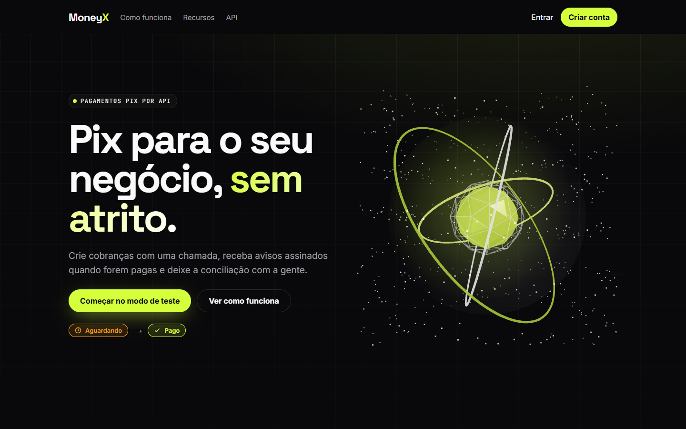
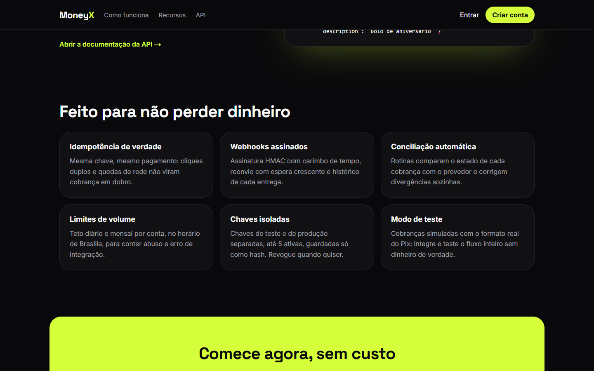
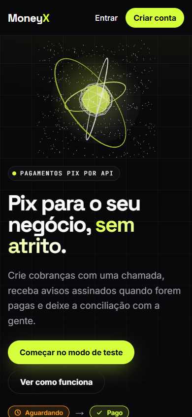
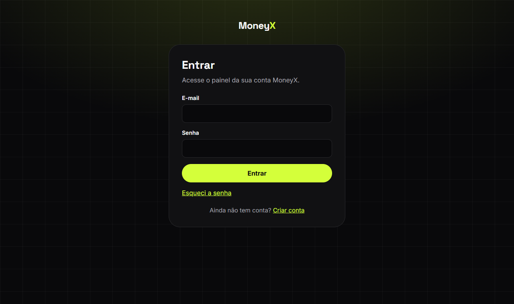
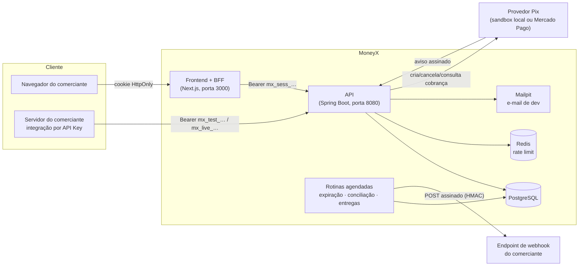
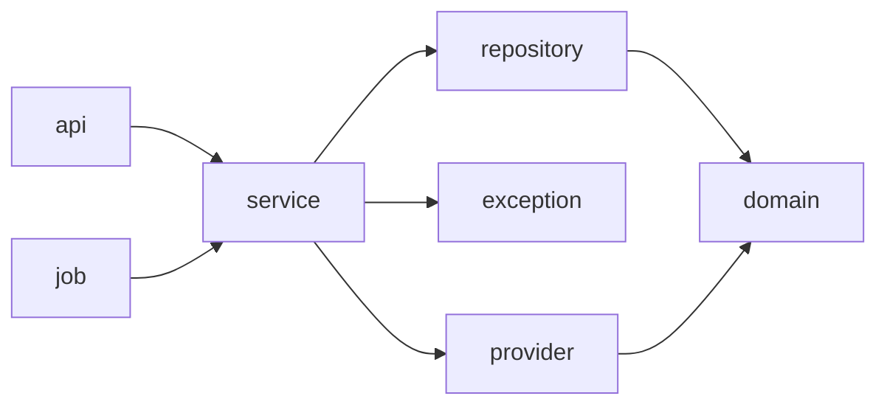
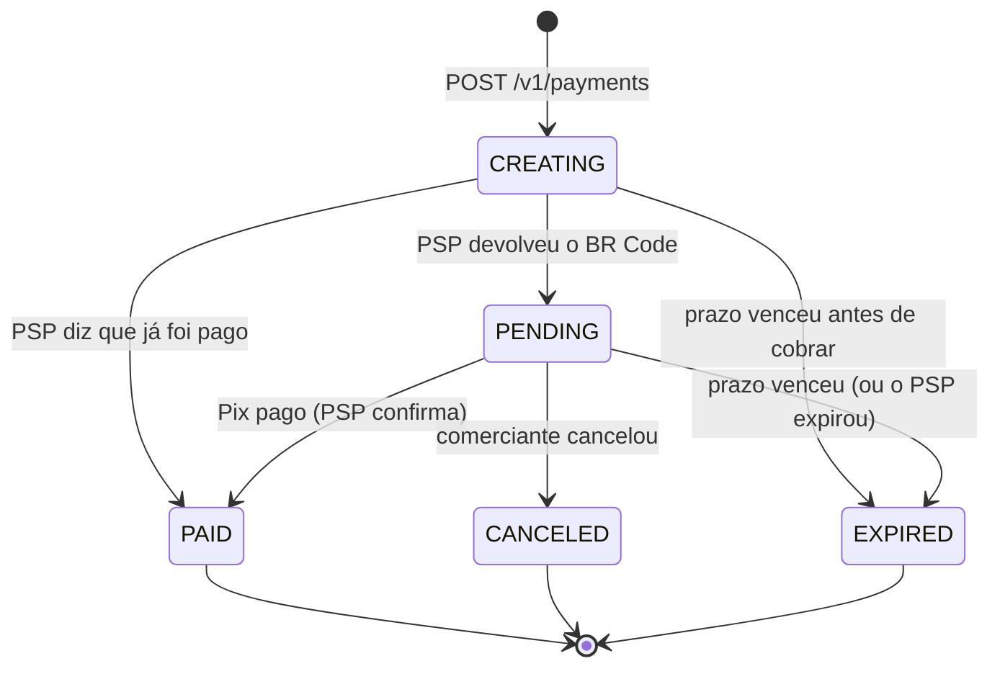
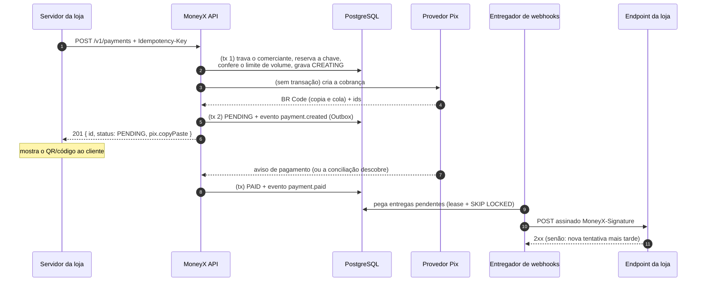

<div align="center">

# MoneyX

**Infraestrutura de pagamentos Pix por API: cobranças, webhooks assinados, conciliação com o provedor e painel do comerciante.**

[](https://github.com/ArthurCoode/MoneyX/actions/workflows/ci.yml)
[](https://github.com/ArthurCoode/MoneyX/actions/workflows/frontend.yml)
[](https://github.com/ArthurCoode/MoneyX/actions/workflows/e2e.yml)

Java 25 · Spring Boot 4 · PostgreSQL 17 · Redis · Next.js 16 · React 19 · Three.js · Docker



</div>

---

## Sumário

1. [O que é o MoneyX](#1-o-que-é-o-moneyx)
2. [Destaques](#2-destaques)
3. [Telas](#3-telas)
4. [Arquitetura](#4-arquitetura)
5. [Como um pagamento acontece](#5-como-um-pagamento-acontece)
6. [Confiabilidade: como o MoneyX evita perder ou duplicar dinheiro](#6-confiabilidade-como-o-moneyx-evita-perder-ou-duplicar-dinheiro)
7. [Segurança](#7-segurança)
8. [Stack](#8-stack)
9. [Como rodar](#9-como-rodar)
10. [Usando a API](#10-usando-a-api)
11. [Recebendo webhooks](#11-recebendo-webhooks)
12. [Referência dos endpoints](#12-referência-dos-endpoints)
13. [Desenvolvimento](#13-desenvolvimento)
14. [Testes](#14-testes)
15. [CI/CD e cadeia de suprimentos](#15-cicd-e-cadeia-de-suprimentos)
16. [Variáveis de ambiente](#16-variáveis-de-ambiente)
17. [Estrutura do repositório](#17-estrutura-do-repositório)
18. [Limitações conhecidas](#18-limitações-conhecidas)
19. [Histórico do projeto](#19-histórico-do-projeto)

---

## 1. O que é o MoneyX

O MoneyX é uma plataforma de **infraestrutura de pagamentos** no estilo de gateways como Stripe e Mercado Pago, focada
em **Pix**. Um comerciante se cadastra, recebe chaves de API, cria cobranças Pix pelo próprio sistema, recebe avisos
(webhooks) quando elas são pagas e acompanha tudo por um painel web.

O objetivo é construir, com padrões de engenharia de sistemas financeiros reais, tudo o que existe **por trás** de um
"criar cobrança": idempotência, máquina de estados, isolamento entre clientes, eventos, entregas confiáveis, conciliação
com o provedor, limites, segurança e rastreabilidade. Não é um CRUD de demonstração.

> [!IMPORTANT]
> **Projeto de estudo e portfólio.** O MoneyX não é uma instituição autorizada pelo Banco Central nem participante do
> Pix (SPI/DICT). Por padrão, ele roda com o **provedor sandbox**: as cobranças têm o formato real do Pix (BR Code
> válido, CRC16 incluso), mas não são pagáveis em um banco; o pagamento é **simulado**. Opcionalmente, ele se integra ao
> **sandbox do Mercado Pago** (credenciais de teste), como um gateway faria com um PSP parceiro.

## 2. Destaques

| | |
|---|---|
| **Idempotência de verdade** | `Idempotency-Key` obrigatória ao criar cobrança: repetir a chamada (clique duplo, queda de rede, retry) devolve o **mesmo** pagamento. Comprovado por teste ponta a ponta que derruba a resposta na rede depois que o servidor criou a cobrança. |
| **Criação em três fases** | Nenhuma transação de banco fica aberta esperando a rede do provedor; uma cobrança interrompida no meio é retomada automaticamente. |
| **Webhooks assinados** | HMAC-SHA256 com carimbo de tempo (`MoneyX-Signature: t=…,v1=…`), 9 tentativas com espera crescente e *jitter* (~2,7 dias), desativação automática, reenvio manual e histórico de cada entrega. |
| **Outbox transacional** | O evento é gravado **na mesma transação** da mudança de estado: ou os dois acontecem, ou nenhum. |
| **Conciliação com o PSP** | Rotinas comparam cada cobrança com o provedor e corrigem divergências; quem decide se o Pix foi pago é o PSP. |
| **Multi-tenant seguro** | Todo dado pertence a um comerciante; recurso de outro comerciante responde `404` (não revela que existe). |
| **Limites de volume** | Teto diário e mensal por comerciante, no fuso de São Paulo, com trava pessimista contra corrida. |
| **Segurança em camadas** | API Keys só como hash, segredos cifrados com AES-256-GCM e rotação de chave, Argon2id nas senhas, rate limit, proteção contra SSRF, CSP com nonce, CSRF por Origin, containers sem root. |
| **Painel do comerciante** | Next.js como BFF: o navegador nunca vê token de API nem de sessão (cookie `HttpOnly`). |
| **Testes que provam** | ~743 testes no backend com PostgreSQL real (Testcontainers), 69 no frontend e 13 ponta a ponta, mais **testes de mutação** nas partes de dinheiro (o bug é plantado de propósito para provar que algum teste falha). |

## 3. Telas

<table>
  <tr>
    <td width="62%"></td>
    <td width="38%"></td>
  </tr>
  <tr>
    <td colspan="2"></td>
  </tr>
</table>

- **Landing page** com cena 3D própria (React Three Fiber) e revelação na rolagem (GSAP). Com "reduzir movimento"
  ligado no sistema (ou sem WebGL), a página mostra um fundo estático e nem baixa o three.js.
- **Painel** com visão geral, pagamentos (lista, filtro, paginação, nova cobrança, detalhe com Pix copia e cola,
  simular pagamento, cancelar), API Keys, webhooks (entregas, reenvio, histórico) e eventos.
- **Paleta "Lime Noir"**: preto, branco e verde-limão, com contraste WCAG AA conferido (o menor par é 6,2:1). Estado de
  pagamento nunca só pela cor: sempre texto + ícone.

## 4. Arquitetura

### Visão geral



- O **navegador nunca fala com a API Java**. Ele fala com o servidor do Next.js (o BFF, *backend for frontend*), que
  guarda a sessão num cookie `HttpOnly` e chama a API do lado do servidor.
- A integração do comerciante (o servidor da loja) usa **API Keys**, como em qualquer gateway.
- A API é a **única dona dos dados**; o frontend conhece o backend apenas pelo **contrato OpenAPI** (os tipos
  TypeScript são gerados dele: se a API muda, o build do frontend quebra).

### Monólito modular

O backend é **um único serviço** dividido em módulos com fronteiras claras (*package by feature*). É mais simples de
operar e evoluir que microsserviços, e qualquer módulo pode ser extraído depois, se houver necessidade real.

| Módulo | Responsabilidade |
|---|---|
| `merchant` | Cadastro, conta, verificação de e-mail, login, sessões do painel e redefinição de senha |
| `apikey` | Criação, listagem e revogação de API Keys (`mx_test_`, `mx_live_`) |
| `payment` | Cobranças Pix, máquina de estados, idempotência, limites de volume, expiração e conciliação; `provider/` é a porta para o PSP |
| `event` | Histórico de eventos (Outbox) e retenção; genérico, não conhece os módulos de negócio |
| `webhook` | Endpoints do comerciante, entregas assinadas, retentativas, desativação automática e linha do tempo |
| `security` | Spring Security: autenticação por API Key ou sessão, rate limit, respostas 401/403 |
| `docs` | Configuração do contrato OpenAPI e da Swagger UI |
| `shared` | Código transversal: Problem Details, id de correlação, relógio, criptografia |

Cada módulo segue as mesmas camadas, com dependências **sempre na mesma direção**:



- `domain` não depende de nada: entidades **sem setters**, e toda mudança de estado passa por um método que valida a
  transição.
- Entidades JPA nunca saem pela API (a camada `api` usa DTOs).
- Entre módulos, a referência é só pelo id (`merchantId`), sem `@ManyToOne`; a integridade fica com as FKs do banco.
- Quando `event` precisa perguntar algo a quem o usa, ele declara uma interface e o outro módulo a implementa
  (inversão de dependência).

## 5. Como um pagamento acontece

### Máquina de estados



- `PAID`, `CANCELED` e `EXPIRED` são **finais**. Transição inválida é recusada no domínio, não só na API.
- Valores sempre em **centavos (`long`)**, nunca em ponto flutuante: de R$ 1,00 a R$ 100.000,00 por cobrança. O JSON
  recusa decimais em campos inteiros (sem isso, `4990.5` viraria `4990` em silêncio).
- Prazo do Pix: padrão de 30 minutos, de 5 minutos a 24 horas.

### Do pedido ao webhook



## 6. Confiabilidade: como o MoneyX evita perder ou duplicar dinheiro

**Idempotência.** A `Idempotency-Key` é única por comerciante (constraint `UNIQUE` no banco) e vale por 24 h. A mesma
chave com o mesmo corpo devolve o pagamento original (`Idempotent-Replayed: true`); a mesma chave com outro corpo dá
`422 idempotency_key_reused`. Requisições simultâneas com a mesma chave **esperam a primeira** (lock do índice) e
recebem o mesmo resultado. Erros de validação desfazem a reserva, então dá para corrigir e reenviar com a mesma chave.

**Criação em três fases.** Chamar um provedor pela rede dentro de uma transação deixaria o comerciante travado se o
provedor demorasse. Por isso: (1) transação curta grava `CREATING`; (2) chamada ao PSP **fora** de transação, sempre
com o mesmo pedido (o PSP também é idempotente); (3) transação curta grava `PENDING`. Se o PSP está fora, a resposta é
`503` com `Retry-After`, e repetir com **a mesma chave** retoma a criação. Uma rotina a cada 30 s conclui as que
ficaram pelo caminho.

**Outbox transacional.** Cada mudança de estado grava o evento na mesma transação. Webhooks e métricas nascem desse
evento confirmado: nunca se avisa a loja de algo que foi desfeito.

**Entregas de webhook "pelo menos uma vez".** O entregador reserva lotes com `lease` (prazo de posse) e
`SELECT … FOR UPDATE SKIP LOCKED`, envia **fora** de transação e só grava o resultado se ainda for o dono da reserva.
Se cair no meio, a reserva vence e outra instância reenvia. Por isso a loja deve **deduplicar pelo id do evento**.

**Retentativas.** 9 tentativas: imediata e depois 1 min, 5 min, 30 min, 2 h, 5 h, 10 h, 24 h e 24 h (~2,7 dias),
com ±10% de *jitter* para não sincronizar picos. Um endpoint que falha há 3 dias seguidos é desativado
automaticamente (com registro na linha do tempo) e pode ser reativado pelo painel.

**Conciliação.** O MoneyX nunca marca como expirada ou cancelada uma cobrança do PSP sem o PSP confirmar. A cada
30 s, uma rotina compara as cobranças abertas com o provedor. Se o PSP diz que recebeu o Pix, o pagamento vira `PAID`
mesmo depois do prazo local, porque o dinheiro já saiu do pagador.

**Corridas.** Regras do tipo "no máximo N" (5 API Keys, 5 endpoints, limite de volume) travam as linhas do comerciante
(`SELECT … FOR UPDATE` / `FOR NO KEY UPDATE`) **antes** de contar. Há testes de concorrência que falham sem a trava.

**Retenção.** Eventos e entregas finalizadas são apagados depois de 30 dias, em lotes (como no Stripe); pendentes,
nunca.

## 7. Segurança

**Autenticação e contas**
- API Keys (`mx_test_…`, `mx_live_…`) guardadas apenas como **hash SHA-256**; o segredo aparece uma única vez, com
  `Cache-Control: no-store`. Até 5 ativas, e a última ativa não pode ser revogada.
- Chaves de produção (`mx_live_`) exigem **e-mail confirmado** e não acessam as rotas de simulação (`/v1/sandbox/**`).
- Senhas do painel com **Argon2id** (19 MiB, t=2, p=1, o mínimo da OWASP), de 12 a 128 caracteres, sem regras de
  composição (como recomenda o NIST 800-63B). O login responde igual para e-mail inexistente e senha errada, inclusive
  no **tempo**: o Argon2 roda contra um hash falso quando a conta não existe.
- Sessões do painel: 6 h sem uso ou 24 h no máximo; a redefinição de senha derruba **todas** as sessões.

**Ataques de força bruta e abuso**
- Rate limit (token bucket, compartilhado no Redis): cadastro 5 por IP (+1 a cada 2 min); login 20 por IP e
  10 por e-mail; redefinição de senha 5 por IP e 3 por e-mail. Resposta `429` + `Retry-After`.
- IPv6 é agrupado por /64. `X-Forwarded-For` só vale vindo de um **proxy confiável** configurado; o frontend
  sobrescreve qualquer `X-Forwarded-For` forjado pelo visitante com o IP real da conexão.

**Dados sensíveis**
- Segredos de assinatura dos webhooks cifrados com **AES-256-GCM**, com chaveiro de duas posições (ativa e anterior)
  e recifragem automática para rotacionar a chave sem parar o serviço.
- Logs nunca contêm API Key, segredo `whsec_`, documento, e-mail ou senha (há teste que garante).

**Rede e navegador**
- **SSRF:** URL de webhook precisa ser `https` pública; o DNS é resolvido **a cada entrega**, e IPs internos
  (`127.0.0.1`, `10.x`, `169.254.169.254`…) são recusados sem conectar. Redirecionamentos não são seguidos.
- **CSP com nonce** por requisição no frontend (só roda script que o servidor marcou), `frame-ancestors 'none'`,
  `object-src 'none'`. A API usa `default-src 'none'`.
- **CSRF:** cookie `SameSite=Lax` + recusa de qualquer escrita sem `Origin` do próprio site (a checagem nativa do
  Next.js só avisa quando o `Origin` falta).
- Cookie `__Host-mx_session`: `HttpOnly`, `Secure`, `Path=/`, sem `Domain`.

**Infraestrutura**
- Imagens base fixadas por **digest**; containers com usuário sem privilégios (UID 10001), sistema de arquivos
  somente leitura, nenhuma *capability* do Linux e `no-new-privileges`.
- Portas publicadas só em `127.0.0.1`; o Actuator (saúde e métricas) fica numa porta interna (8081) que não sai do
  container.
- Varredura de vulnerabilidades com **Trivy** nas duas imagens, bloqueante no CI.

## 8. Stack

| Camada | Tecnologias |
|---|---|
| Backend | Java 25 LTS, Spring Boot 4.1.2 (Web MVC, Data JPA, Security, Validation, Actuator, Mail), Hibernate, Flyway, Micrometer + Prometheus, springdoc-openapi 3.2 (OpenAPI 3.1), Bouncy Castle (Argon2) |
| Banco e cache | PostgreSQL 17 (fonte da verdade, 17 migrations), Redis 8 (baldes do rate limit) |
| Frontend | Next.js 16 (App Router, Server Actions, `output: standalone`), React 19, TypeScript 5.9, CSS Modules com tokens, React Three Fiber + drei + three.js, GSAP ScrollTrigger, openapi-typescript + openapi-fetch |
| Testes | JUnit 5, Mockito, Testcontainers 2 (PostgreSQL real), Vitest + Testing Library, Playwright |
| Infra | Docker (multi-stage), Docker Compose, Mailpit (caixa de e-mail falsa), GitHub Actions, Dependabot, Trivy |
| Provedor Pix | Sandbox local (BR Code conforme o manual do BCB) ou Mercado Pago (API de Orders, ambiente de teste) |

## 9. Como rodar

### Pré-requisitos

- **Docker Desktop** (com Docker Compose). É tudo o que você precisa para rodar o projeto inteiro.
- Para desenvolver: **JDK 25** e **Node.js 26**.

### Subindo tudo

```powershell
git clone https://github.com/ArthurCoode/MoneyX.git
cd MoneyX
copy .env.example .env          # Linux/macOS: cp .env.example .env
```

Abra o `.env` e preencha `POSTGRES_PASSWORD` e `MONEYX_WEBHOOK_ENCRYPTION_KEY` (o próprio arquivo traz o comando
que gera cada valor com um gerador criptográfico). Depois:

```powershell
docker compose up -d --build
docker compose ps               # todos devem ficar "healthy"
```

O Compose sobe cinco containers: `postgres`, `redis`, `mailpit`, `app` (a API) e `frontend`.

| Endereço | O que é |
|---|---|
| http://localhost:3000 | Landing page e painel do comerciante |
| http://localhost:8080/swagger-ui.html | Documentação interativa da API (abra por `localhost`, não por `127.0.0.1`) |
| http://localhost:8080/v3/api-docs | Contrato OpenAPI 3.1 em JSON |
| http://localhost:8025 | Mailpit: os e-mails de confirmação e de redefinição de senha caem aqui |

### Primeiro uso

1. Acesse http://localhost:3000 e clique em **Criar conta**.
2. Guarde a **chave de API de teste** exibida (ela não aparece de novo).
3. Confirme o e-mail pelo link que chega no Mailpit (http://localhost:8025).
4. No painel, crie uma cobrança em **Pagamentos → Nova cobrança Pix** e use **Simular pagamento**.

> [!TIP]
> Se aparecer um erro de rede ao subir, confira se a faixa `172.30.0.0/24` está livre na sua máquina. O frontend usa
> um IP fixo nela para a API saber em quem confiar ao ler o IP do visitante (veja o `compose.yaml`).

### Comandos úteis

```powershell
docker compose logs -f app            # logs da API
docker compose logs -f frontend       # logs do frontend
docker compose down                   # para tudo (os dados do banco continuam no volume)
docker compose down --volumes         # para tudo e APAGA o banco
```

## 10. Usando a API

Todas as chamadas levam a chave no header `Authorization`. Os exemplos usam `curl` (no PowerShell, use `curl.exe`).

**Criar uma cobrança Pix** (R$ 89,90, vencendo em 1 hora):

```bash
curl -X POST http://localhost:8080/v1/payments \
  -H "Authorization: Bearer mx_test_SUA_CHAVE" \
  -H "Idempotency-Key: pedido-1042" \
  -H "Content-Type: application/json" \
  -d '{ "amount": 8990, "currency": "BRL", "description": "Bolo de aniversário",
        "externalReference": "pedido-1042", "expiresInSeconds": 3600 }'
```

```json
{
  "id": "0f8fad5b-d9cb-469f-a165-70867728950e",
  "status": "PENDING",
  "amount": 8990,
  "currency": "BRL",
  "description": "Bolo de aniversário",
  "externalReference": "pedido-1042",
  "pix": { "copyPaste": "00020126580014br.gov.bcb.pix…6304ABCD", "txid": "…" },
  "createdAt": "2026-11-27T13:00:00Z",
  "expiresAt": "2026-11-27T14:00:00Z"
}
```

Repetir **exatamente** a mesma chamada devolve o mesmo pagamento, com o header `Idempotent-Replayed: true`.

**Simular o pagamento** (só no modo de teste):

```bash
curl -X POST http://localhost:8080/v1/sandbox/payments/0f8fad5b-d9cb-469f-a165-70867728950e/pay \
  -H "Authorization: Bearer mx_test_SUA_CHAVE"
```

**Listar pagamentos** (paginação por cursor, como no Stripe):

```bash
curl "http://localhost:8080/v1/payments?limit=20&status=PAID" -H "Authorization: Bearer mx_test_SUA_CHAVE"
# próxima página: &startingAfter=<id do último item>   →   { "data": [...], "hasMore": true }
```

### Erros

Todo erro segue o padrão **Problem Details (RFC 9457)**, com um `code` estável para o seu código tratar e um
`requestId` para o suporte:

```json
{
  "type": "about:blank",
  "title": "Conflict",
  "status": 409,
  "detail": "Payment is not pending",
  "code": "payment_not_pending",
  "requestId": "6a1f0c2e-…"
}
```

Erros de validação trazem também `errors: [{ "field": "amount", "message": "…" }]`. O `detail` é para humanos e pode
mudar; **use o `code`** para tomar decisões.

## 11. Recebendo webhooks

Cadastre um endpoint (painel → **Webhooks**, ou `POST /v1/webhook-endpoints`) e guarde o segredo `whsec_…`, que
aparece uma única vez. Cada aviso chega assim:

```http
POST /webhooks/moneyx HTTP/1.1
Content-Type: application/json
User-Agent: MoneyX-Webhooks/1.0
MoneyX-Event-Id: 3b0e8c4a-…
MoneyX-Event-Type: payment.paid
MoneyX-Signature: t=1763650000,v1=5f2b9c…

{ "id": "3b0e8c4a-…", "type": "payment.paid", "createdAt": "…", "data": { …o pagamento… } }
```

Tipos: `payment.created`, `payment.paid`, `payment.canceled`, `payment.expired`.

**Como verificar a assinatura** (exemplo em Node.js; a chave do HMAC é o segredo **inteiro**, incluindo o prefixo
`whsec_`):

```js
import { createHmac, timingSafeEqual } from "node:crypto";

/** rawBody: o corpo EXATAMENTE como chegou (bytes/texto), sem reformatar o JSON. */
export function verifyMoneyXSignature(rawBody, signatureHeader, secret, toleranceSeconds = 300) {
  const parts = Object.fromEntries(signatureHeader.split(",").map((pair) => pair.split("=")));
  const timestamp = Number(parts.t);
  // Recusa avisos velhos: impede que alguém reenvie um aviso capturado (replay).
  if (!Number.isFinite(timestamp) || Math.abs(Date.now() / 1000 - timestamp) > toleranceSeconds) return false;

  const expected = createHmac("sha256", secret).update(`${timestamp}.${rawBody}`).digest("hex");
  const received = Buffer.from(parts.v1 ?? "", "utf8");
  const wanted = Buffer.from(expected, "utf8");
  // Comparação em tempo constante: não vaza quantos caracteres batem.
  return received.length === wanted.length && timingSafeEqual(received, wanted);
}
```

Boas práticas do lado da loja:

- Responda **2xx rápido** e processe depois. Sem 2xx, o MoneyX tenta de novo.
- **Deduplique pelo `MoneyX-Event-Id`**: a entrega é "pelo menos uma vez", então o mesmo aviso pode chegar duas vezes.
- Não dependa da ordem de chegada. Na dúvida, consulte `GET /v1/payments/{id}` para saber o estado atual.

A implementação de referência está em `src/main/java/com/moneyx/webhook/domain/WebhookSignature.java`.

## 12. Referência dos endpoints

A referência completa (corpos, respostas e exemplos) está na **Swagger UI** (http://localhost:8080/swagger-ui.html).

| Método e rota | Autenticação | O que faz |
|---|---|---|
| `POST /v1/merchants` | pública | Cadastro (devolve a primeira API Key de teste) |
| `GET /v1/merchants/me` | chave ou sessão | Dados do comerciante e limites de volume |
| `GET /v1/merchants/verify-email?token=` | pública | Confirma o e-mail (link do e-mail) |
| `POST /v1/merchants/me/email-verification` | chave ou sessão | Reenvia o e-mail de confirmação |
| `POST /v1/merchants/password-reset` | pública | Pede o link de redefinição (responde `202` sempre) |
| `POST /v1/merchants/password-reset/confirm` | pública | Define a nova senha com o token do link |
| `POST /v1/sessions` · `DELETE /v1/sessions/current` | pública · sessão | Login e logout do painel |
| `GET`/`POST /v1/api-keys` · `DELETE /v1/api-keys/{id}` | chave ou sessão | Listar, criar e revogar API Keys |
| `POST /v1/payments` | chave ou sessão | Criar cobrança Pix (exige `Idempotency-Key`) |
| `GET /v1/payments` · `GET /v1/payments/{id}` | chave ou sessão | Listar (filtros `status`, `externalReference`) e consultar |
| `POST /v1/payments/{id}/cancel` | chave ou sessão | Cancelar (só `PENDING`; idempotente) |
| `POST /v1/sandbox/payments/{id}/pay` | chave de teste | Simular o pagamento do Pix |
| `GET /v1/events` · `GET /v1/events/{id}` | chave ou sessão | Histórico de eventos (mesmo conteúdo dos webhooks) |
| `GET`/`POST /v1/webhook-endpoints` · `GET`/`DELETE /v1/webhook-endpoints/{id}` | chave ou sessão | Endpoints de webhook |
| `POST /v1/webhook-endpoints/{id}/enable` | chave ou sessão | Reativar um endpoint desativado |
| `GET /v1/webhook-endpoints/{id}/deliveries` · `/history` | chave ou sessão | Entregas e linha do tempo do endpoint |
| `POST /v1/webhook-deliveries/{id}/retry` | chave ou sessão | Reenviar uma entrega que falhou |
| `POST /v1/provider-webhooks/mercadopago` | assinatura do MP | Aviso do Mercado Pago (`x-signature`) |

Regras gerais: listas sempre em envelope `{"data": [...]}`; ações que mudam estado usam `POST /recurso/{id}/<ação>`;
`DELETE` é idempotente; recurso de outro comerciante responde `404`; mensagens da API em inglês, sempre.

## 13. Desenvolvimento

### Backend (API)

```powershell
docker compose up -d postgres redis mailpit     # só a infraestrutura
.\mvnw.cmd spring-boot:run                      # a API em http://localhost:8080 (JAVA_HOME = JDK 25)
```

A aplicação **recusa subir** sem `POSTGRES_PASSWORD` e `MONEYX_WEBHOOK_ENCRYPTION_KEY`, com uma mensagem dizendo
qual variável falta (melhor que um erro enganoso de autenticação no banco). Para carregar o `.env` na sessão do
PowerShell:

```powershell
foreach ($n in "POSTGRES_PASSWORD", "MONEYX_WEBHOOK_ENCRYPTION_KEY") {
  Set-Item -Path "Env:$n" -Value ((Get-Content .env | Where-Object { $_ -match "^$n=" }) -split '=', 2)[1]
}
```

- **Banco:** o esquema é só do **Flyway** (`src/main/resources/db/migration`, `V1` a `V17`); o Hibernate apenas
  valida. Migration aplicada nunca é editada: mudança = nova versão.
- **Contrato OpenAPI:** mudou a API de propósito? Regenere o contrato versionado (o teste `OpenApiContractTest`
  falha se ele ficar desatualizado):
  ```powershell
  .\mvnw.cmd test -Dtest=OpenApiContractTest -Dopenapi.update=true
  ```

### Frontend

```powershell
cd frontend
npm ci
npm run dev            # http://localhost:3000 (a API precisa estar em http://localhost:8080)
npm run api:types      # regenera os tipos TypeScript a partir do contrato OpenAPI
```

| Script | O que faz |
|---|---|
| `npm run lint` | ESLint (regras do Next.js, React e acessibilidade) |
| `npm run typecheck` | TypeScript estrito (`noUncheckedIndexedAccess`) |
| `npm test` | Testes unitários (Vitest) |
| `npm run e2e` | Testes ponta a ponta (Playwright) contra um ambiente já no ar |
| `npm run build` | Build de produção |

Organização: `src/app` (rotas: `(conta)` para login e cadastro, `painel` para o dashboard, `actions` para as Server
Actions), `src/lib/server` (código só de servidor: cliente da API, sessão), `src/components` e `src/styles/tokens.css`
(**o único lugar com valores de cor**).

## 14. Testes

| Camada | Ferramentas | O que cobre |
|---|---|---|
| Backend (~743 testes) | JUnit 5, Mockito, Testcontainers | Domínio e transições, serviços, controllers, segurança, concorrência (com e sem trava), contrato OpenAPI, headers HTTP num Tomcat real, logs sem dados sensíveis |
| Frontend (69 testes) | Vitest, Testing Library | CSRF, CSP, IP do visitante, dinheiro em texto ↔ centavos, fuso horário, mensagens de erro, redirecionamento seguro, guarda do `X-Forwarded-For` com servidor HTTP real |
| Ponta a ponta (13 testes) | Playwright + Compose | Cadastro → painel → sair → entrar → esqueci a senha (e-mail real no Mailpit) → nova senha; cobrança, simulação, cancelamento, filtros e eventos; idempotência com queda de rede; API Keys; webhooks; **isolamento entre comerciantes**; CSP bloqueando HTML injetado; 3D e "reduzir movimento" |

```powershell
.\mvnw.cmd verify                 # backend (precisa só do Docker aberto: o banco dos testes é descartável)
cd frontend; npm test             # frontend
cd frontend; npm run e2e          # ponta a ponta (com o Compose no ar)
```

**Testes de mutação.** Nas partes que envolvem dinheiro ou segurança, cada teste importante foi validado plantando o
bug de propósito (remover uma trava, inverter uma condição, aceitar uma chave de idempotência nova a cada envio…) e
conferindo que **algum teste falha**, sempre com uma rodada de controle sem o bug. Várias falhas reais e testes fracos
foram encontrados assim.

> [!NOTE]
> Rodar o E2E de novo em menos de ~10 minutos esbarra no limite de cadastros por IP (5). Para limpar os baldes do
> rate limit no ambiente de desenvolvimento:
> `docker exec moneyx-redis sh -c "redis-cli --scan --pattern 'moneyx:ratelimit:*' | xargs -r redis-cli del"`

## 15. CI/CD e cadeia de suprimentos

| Workflow | Quando roda | O que faz |
|---|---|---|
| `ci.yml` | mudanças no backend | Build e testes (Testcontainers) com JDK 25; imagem Docker da API + Trivy (bloqueante) |
| `frontend.yml` | mudanças em `frontend/` ou no contrato | Tipos em dia com o contrato, lint sem avisos, typecheck, testes, build, `npm audit` |
| `e2e.yml` | mudanças no backend, frontend ou Compose | Sobe o Compose com segredos descartáveis, Trivy na imagem do frontend, Playwright; guarda traces e logs se falhar |

- Actions fixadas pelo **hash do commit** (não por tag), permissões mínimas (`contents: read`), execuções antigas
  canceladas.
- **Dependabot** semanal para Maven, npm, Docker (backend e frontend) e Actions, com *cooldown* (só propõe versões com
  alguns dias de publicadas) e atualizações maiores em PRs separados.
- Imagens base por **digest**; nenhum segredo dentro das imagens.

## 16. Variáveis de ambiente

| Variável | Onde | Para quê |
|---|---|---|
| `POSTGRES_DB`, `POSTGRES_USER`, `POSTGRES_PASSWORD` | `.env` | Banco de dados (**obrigatórias**) |
| `MONEYX_WEBHOOK_ENCRYPTION_KEY` | `.env` | Chave AES-256 (Base64, 32 bytes) que cifra os segredos de webhook (**obrigatória**) |
| `MONEYX_WEBHOOK_ENCRYPTION_KEY_PREVIOUS` | `.env` | Chave anterior, só durante uma rotação |
| `MONEYX_PIX_PROVIDER` | `.env` | `sandbox` (padrão) ou `mercadopago` |
| `MERCADOPAGO_ACCESS_TOKEN`, `MERCADOPAGO_WEBHOOK_SECRET` | `.env` | Credenciais de teste do Mercado Pago |
| `MONEYX_TRUSTED_PROXIES` | Compose | Regex dos IPs de proxy confiáveis (padrão: só o frontend) |
| `MONEYX_PUBLIC_BASE_URL` | Compose | Endereço público da API (link do e-mail de confirmação) |
| `MONEYX_DASHBOARD_BASE_URL` | Compose | Endereço do painel (link de redefinição de senha) |
| `MONEYX_RATE_LIMIT_STORE` | Compose | `memory` ou `redis` |
| `MONEYX_API_URL` | frontend | Endereço da API visto pelo servidor do Next (`http://app:8080` no Compose) |
| `MONEYX_PUBLIC_API_URL` | frontend | Endereço da API visto pelo navegador (link da documentação) |
| `MONEYX_TRUST_FORWARDED_FOR` | frontend | `true` só com um proxy confiável **na frente** do frontend |

## 17. Estrutura do repositório

```text
MoneyX/
├── src/main/java/com/moneyx/
│   ├── merchant/   apikey/   payment/   event/   webhook/     ← módulos de negócio
│   ├── security/   docs/                                      ← autenticação e contrato OpenAPI
│   └── shared/                                                ← transversal (erros, observabilidade, cripto)
├── src/main/resources/db/migration/                           ← V1..V17 (Flyway)
├── src/test/                                                  ← testes + contrato OpenAPI versionado
├── frontend/
│   ├── src/app/          ← rotas (landing, (conta), painel) e Server Actions
│   ├── src/components/   ← landing (3D), dashboard, form, payment
│   ├── src/lib/          ← cliente da API gerado, sessão, formatação, segurança
│   ├── server/           ← guarda do X-Forwarded-For (carregado antes do Next)
│   ├── test/   e2e/      ← Vitest e Playwright
│   └── Dockerfile
├── .github/              ← workflows e Dependabot
├── docs/images/          ← imagens deste README
├── Dockerfile            ← imagem da API
├── compose.yaml          ← ambiente completo
└── .env.example          ← modelo do .env
```

## 18. Limitações conhecidas

Ser honesto sobre o que falta faz parte de um projeto de pagamentos:

- **Não é um arranjo Pix real.** Sem autorização do Banco Central nem chave no DICT, o BR Code do sandbox não é
  pagável em banco; o Mercado Pago é usado só no ambiente de teste.
- **Chaves `mx_live_` e `mx_test_` enxergam os mesmos dados.** Não há separação de ambientes como no Stripe, nem KYC
  de documentos (só a confirmação de e-mail).
- **DNS rebinding:** entre a checagem do IP e a conexão do webhook existe uma janela mínima; a solução completa é um
  proxy de saída dedicado.
- **Sem reembolso** (estorno) na primeira versão.
- O documento (CPF/CNPJ) é validado só pelo formato, sem consulta à Receita.

## 19. Histórico do projeto

| Fase | Entregas |
|---|---|
| 1. Fundação | Spring Boot, PostgreSQL em Docker, Flyway |
| 2. Comerciantes | Cadastro com regras de unicidade no serviço e no banco |
| 3. Segurança | API Keys com hash, filtro do Spring Security, proteção contra IDOR, isolamento entre comerciantes |
| 4. Pagamentos | Modelo em centavos, máquina de estados, idempotência, BR Code, consulta, cancelamento, expiração |
| 5. Eventos e webhooks | Outbox, endpoints com segredo cifrado, entregas assinadas com lease, retentativas e desativação automática |
| 6. Qualidade | CI com Testcontainers, rate limit, OpenAPI, observabilidade, Docker endurecido, Trivy, retenção, limites de volume, rotação de chave |
| 7. Provedor real | Porta para o PSP, Mercado Pago, criação em três fases, conciliação, aviso assinado do MP, Java 25, Redis, chaves `mx_live_` |
| 8. Frontend | Login com Argon2id, BFF com CSP e CSRF, painel completo, landing 3D, imagem Docker, E2E no CI |

---

<div align="center">

Feito por **Arthur Marques** ([@ArthurCoode](https://github.com/ArthurCoode)) como projeto de estudo de arquitetura
de sistemas de pagamento.

</div>
